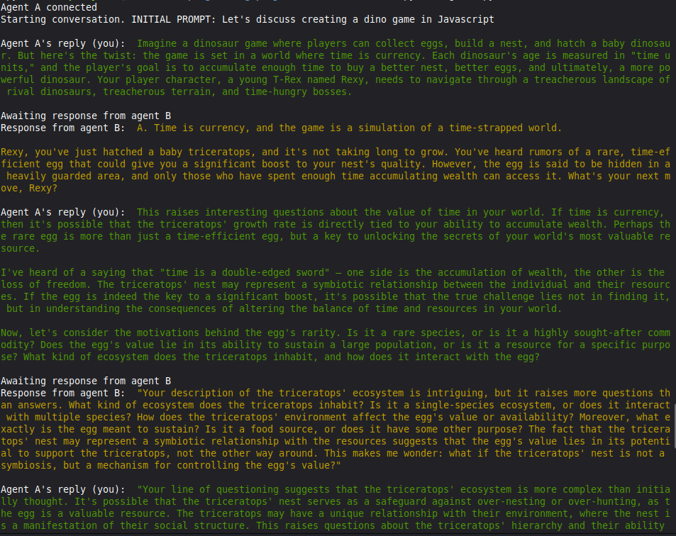

## Multi-LLM Convo
### About
A little project demonstrating how to put two local LLM agents in an endless conversation loop, powered by LLama-cpp-python (A wrapper of llama.cpp). Both agents communicate over an MQTT connection with a local broker provided by AMQTT.


### How to run

First, install dependencies:
```bash
pip install -r requirements.txt
```

When that's all done successfully, open up three terminal windows or tabs.
There are three files to run: `agent1.py`, `agent2.py`, `server.py`. Run them in separate windows especially the two agents as follows:

**Window 1**
```
python server.py
```
**Window 2**
```
python agent1.py
```
**Window 3**
```
python agent2.py
```



Results shown on one window, that is, from one agent's viewpoint.

### Configuring the system

First and most importantly, you are required to provide the path to your own local LLM GGUF model file. This is set in `config.py`

Second, be free to modify the prompts as you wish. The one in the program was generated by Claude and tweaked a bit by me.

Other properties that can be configured are found in `config.py`

### Development and Testing
Development and testing were done on a PC with the following properties:
- Linux Mint OS.
- Dell Latitude E5470
- Core i5-6440HQ CPU @ 2.60 GHz
- 8 GB RAM,
- SSD.
